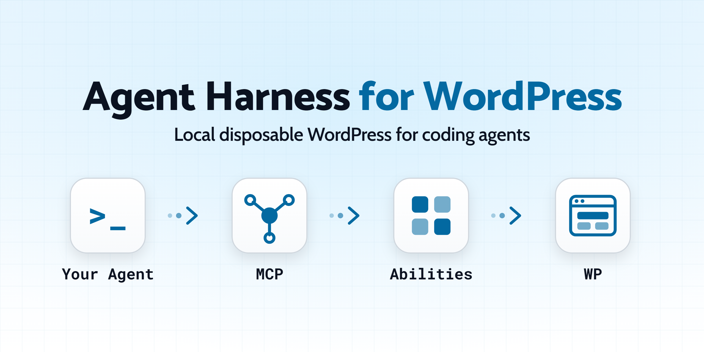
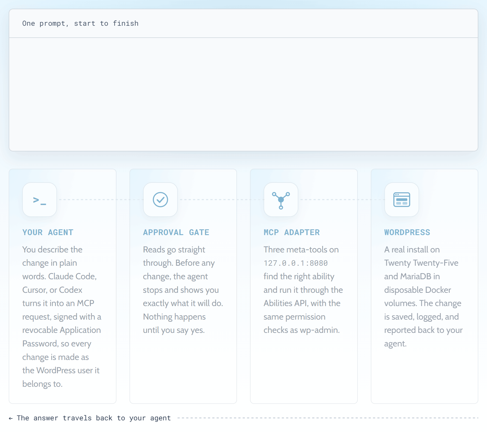
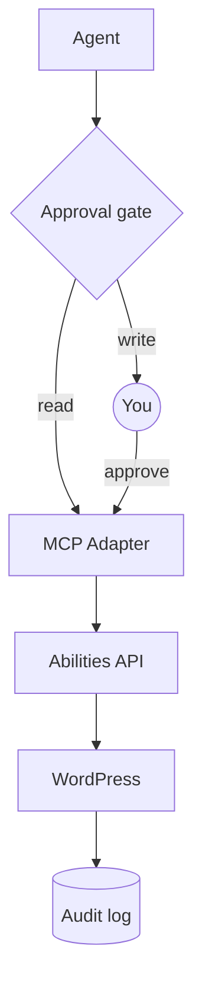

<a href="https://wpagent.marcopontili.com">
  <picture>
    <source media="(prefers-color-scheme: dark)" srcset=".github/brand/readme-dark.png">
    
  </picture>
</a>

# Agent Harness for WordPress

[](LICENSE)
[](https://wordpress.org/)
[](https://mariadb.org/)
[](https://docs.docker.com/compose/)
[](https://github.com/WordPress/mcp-adapter)
[](NOTICE)

A local WordPress site in Docker for Claude Code, Codex, or Cursor.
`./bin/setup` builds it, `./bin/reset` starts over.

Unlike [`wp-env`](https://developer.wordpress.org/block-editor/reference-guides/packages/packages-env/)
or [Playground](https://wordpress.org/playground/), MCP is ready out of the box.
In Claude Code and Cursor the agent asks before every change, and each one is logged.

The agent uses the official [MCP Adapter](https://github.com/WordPress/mcp-adapter)
and [Abilities API](https://developer.wordpress.org/apis/abilities-api/), with the
[MS WordPress Abilities](NOTICE) plugin providing the abilities, all at pinned versions.

Development only: localhost, no production data.

The [website](https://wpagent.marcopontili.com) shows the setup output and the approval
prompt you will answer, before you install anything.

## What you get

| Feature | What it does |
|---------|--------------|
| [Local WordPress](docs/architecture.md#wordpress) | WordPress 7.1 and MariaDB in Docker, localhost only |
| [Abilities](docs/abilities.md) | 29 actions on posts, pages, media, plugins, and REST |
| [Write approval](docs/security.md#the-approval-gate) | You approve every change; reads run freely |
| [Audit log](docs/security.md#the-audit-log) | Every change an agent made or tried |
| [Reset and seed](docs/development.md#commands) | Clean rebuild, sample content |
| [Tests](docs/development.md#testing) | Five layers, up to a live Claude Code session |
| [Agent skills](docs/development.md#agent-skills-vendored) | WordPress conventions for blocks, themes, plugins |

## Quick start

You need Docker Compose v2, Git, Bash, curl, and jq.

```bash
git clone https://github.com/marcop135/wp-agent-harness.git
cd wp-agent-harness
./bin/setup
./bin/status
./bin/connect && claude
```

The site runs at `http://localhost:8080`. You log in to wp-admin as `admin`,
with the password stored as `WP_ADMIN_PASSWORD` in `.env`.

For Codex and Cursor, see the [setup guide](docs/codex.md).

## What to ask your agent

| Task | Prompt |
|------|--------|
| [Inspect](examples/inspect-site.md) | "Inspect the site." |
| [Create](examples/create-content.md) | "Draft a page called About This Site." |
| [Restructure](examples/modify-content.md) | "Restructure the Wholesale draft. Show me first." |
| [Alt text](examples/media.md) | "Propose alt text for images missing it." |
| [Plugins](examples/plugins.md) | "Report plugins and updates. Change nothing." |
| [Section](examples/site-development.md) | "Draft a Services page with three child pages." |
| [Theme](examples/theme.md) | "Explain the active theme's templates." |

## How a request travels

<a href="https://wpagent.marcopontili.com/#how">
  <picture>
    <source media="(prefers-color-scheme: dark)" srcset=".github/brand/request-flow-dark.gif">
    
  </picture>
</a>



## Docs

The [website](https://wpagent.marcopontili.com) has the setup output, the approval prompt, and a FAQ.

| Doc | Covers |
|-----|--------|
| [Development](docs/development.md) | Requirements, commands, versions, URLs, configuration |
| [Abilities](docs/abilities.md) | Every ability, what it does, and whether it asks first |
| [Architecture](docs/architecture.md) | Stack, MCP meta-tools, project structure |
| [Claude Code](docs/claude-code.md) | Claude MCP registration, scopes, skills |
| [Codex and Cursor](docs/codex.md) | MCP setup for Codex and Cursor |
| [AI skills](docs/ai-skills.md) | Agent instructions, MCP, and skills: what lives where |
| [Live site](docs/remote-site.md) | Pointing an agent at a remote site, outside the harness |
| [Security](docs/security.md) | Threat model, bindings, credentials |
| [Troubleshooting](docs/troubleshooting.md) | Common failure modes |
| [Agents](docs/AGENTS.md) | Agent index and domain rules |
| [Examples](examples/README.md) | Worked prompts |

## Contributing

See [CONTRIBUTING.md](CONTRIBUTING.md).

## Author

[Marco Pontili](https://marcopontili.com)

## License

The harness is [MIT](LICENSE).<br>
The [agent skills](https://github.com/WordPress/agent-skills), WordPress, and the plugins keep their own licenses, listed in [NOTICE](NOTICE).
