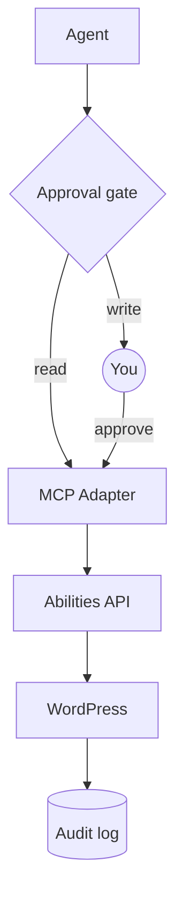

<a href="https://wpagent.marcopontili.com">
  <picture>
    <source media="(prefers-color-scheme: dark)" srcset=".github/brand/readme-dark.png">
    
  </picture>
</a>

# Agent Harness for WordPress

[](LICENSE)
[](https://wordpress.org/)
[](https://mariadb.org/)
[](https://docs.docker.com/compose/)
[](https://github.com/WordPress/mcp-adapter)
[](https://github.com/miriamschwab/ms-wp-abilities)

A real WordPress site on your machine that your coding agent (Claude Code,
Codex, or Cursor) can inspect and build on. One command sets it up in Docker;
another rebuilds it from scratch.

The agent talks to WordPress over MCP: the official
[MCP Adapter](https://github.com/WordPress/mcp-adapter) exposes the
[Abilities API](https://developer.wordpress.org/apis/abilities-api/), and the
[MS WordPress Abilities](https://github.com/miriamschwab/ms-wp-abilities)
plugin provides the abilities. All three come from upstream at pinned versions;
this repo wires them together and adds setup, tests, and agent instructions.

**Development only.** Localhost only, no production data.

Website: [wpagent.marcopontili.com](https://wpagent.marcopontili.com), with the setup and a request from prompt to WordPress played step by step.

## What you get

| Feature | What it does | Where |
|---------|--------------|-------|
| Local WordPress | Runs WordPress 7.1 with the Twenty Twenty-Five theme and MariaDB in Docker. Only your machine can reach it. | `./bin/setup` |
| Abilities | Gives your agent 29 actions on the site: read and edit posts, pages, and media; list menus; manage plugins and themes; call any REST route. | `./bin/wp ability list` |
| Write approval | Makes Claude Code and Cursor ask you before any action that changes the site. Reads run without asking. | [Security](docs/security.md#the-approval-gate) |
| Audit log | Lists every change an agent made or tried to make, with the post or plugin it touched. | `./bin/audit` |
| Demo content | Adds sample pages, posts, and images so the example prompts have something to work on. | `./bin/seed` |
| Reset | Wipes the site and database and rebuilds a clean install. | `./bin/reset` |
| Tests | Checks the stack in five layers, up to a real Claude Code session verified against the database. | `./bin/test` |
| Agent skills | Teaches the agent WordPress conventions for blocks, themes, plugins, REST, and WP-CLI. | `.claude/skills/`, `.cursor/skills/` |

## Quick start

Needs Docker Compose v2, Git, and Bash.

```bash
git clone https://github.com/marcop135/wp-agent-harness.git
cd wp-agent-harness
./bin/setup
./bin/connect && claude
```

Using [Codex](docs/codex.md) or [Cursor](docs/codex.md#claude-code-and-cursor)? `./bin/connect --print` prints the URL and auth header instead.

Check the stack:

```bash
./bin/status
./bin/test --skip-claude    # layers 0–3, no model turns
./bin/wp ability list       # abilities without MCP
```

## What to ask your agent

| Task | Prompt | Site changes |
|------|--------|------------------|
| [Inspect the site](examples/inspect-site.md) | "Inspect the local WordPress site: version, theme, plugins, and content." | None |
| [Create a page](examples/create-content.md) | "Create a draft page called About This Site with a heading, two paragraphs, and a list." | A draft, after you approve |
| [Restructure a page](examples/modify-content.md) | "Improve the structure of the Wholesale draft without changing its meaning. Show me the changes first." | After you approve |
| [Fix alt text](examples/media.md) | "Find images in the media library with no alt text, and propose some." | After you approve |
| [Check plugins](examples/plugins.md) | "Report installed plugins, which are active, and available updates. Do not change anything." | None |
| [Build a section](examples/site-development.md) | "Build a Services page with three child pages, as drafts. Show me the structure first." | Drafts, after you approve |

## How a request travels

<a href="https://wpagent.marcopontili.com/#how">
  <picture>
    <source media="(prefers-color-scheme: dark)" srcset=".github/brand/request-flow-dark.gif">
    
  </picture>
</a>



## Docs

The [website](https://wpagent.marcopontili.com) walks through setup, prompts, and how a request travels.

| Doc | Covers |
|-----|--------|
| [Development](docs/development.md) | Requirements, commands, versions, URLs, configuration |
| [Architecture](docs/architecture.md) | Stack, MCP meta-tools, project structure |
| [Claude Code](docs/claude-code.md) | Claude MCP registration, scopes, skills |
| [Codex](docs/codex.md) | Codex AGENTS.md + `.codex/config.toml` MCP |
| [Live site](docs/remote-site.md) | Pointing an agent at a remote site, outside the harness |
| [Security](docs/security.md) | Threat model, bindings, credentials |
| [Troubleshooting](docs/troubleshooting.md) | Common failure modes |
| [Agents](docs/AGENTS.md) | Agent index and domain rules |
| [Examples](examples/README.md) | Worked prompts |

## Contributing

See [CONTRIBUTING.md](CONTRIBUTING.md).

## Author

[Marco Pontili](https://marcopontili.com)

## License

[MIT](LICENSE) covers this harness: Docker Compose, `bin/`, docs, tests, and the landing page in `site/`.

Agent skills: GPL-2.0-or-later. Upstream software: see [NOTICE](NOTICE).
